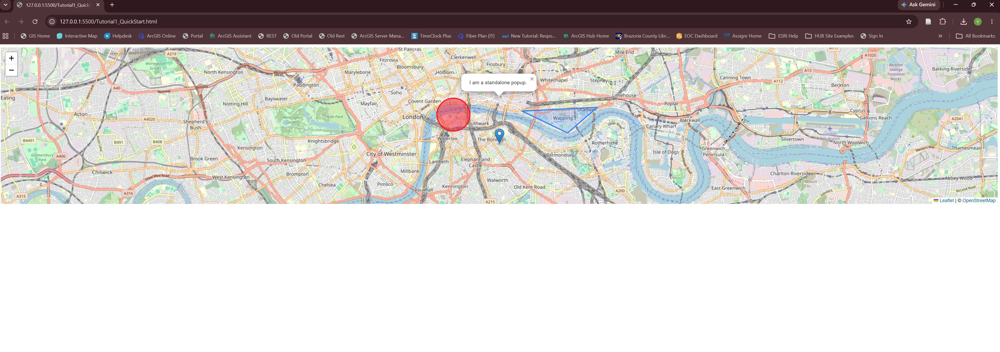
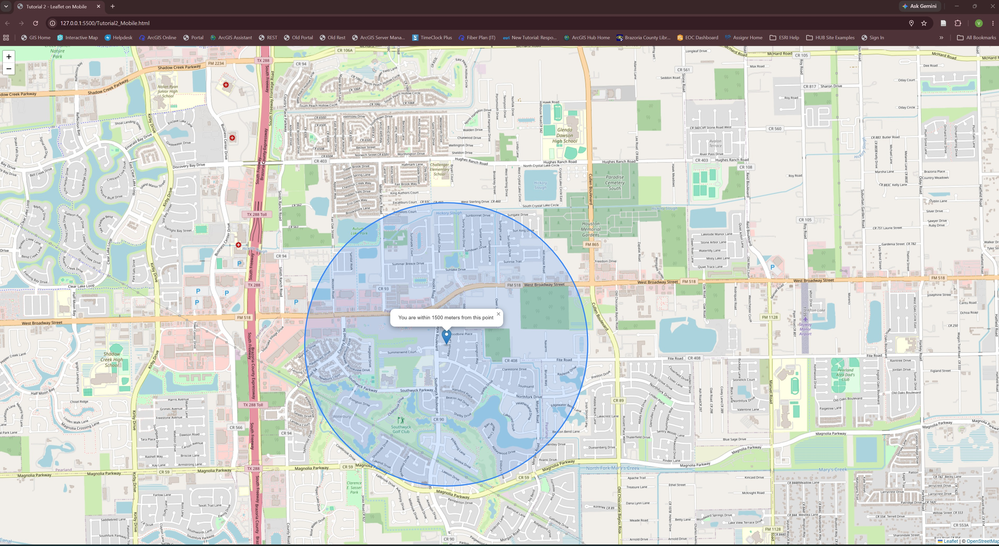
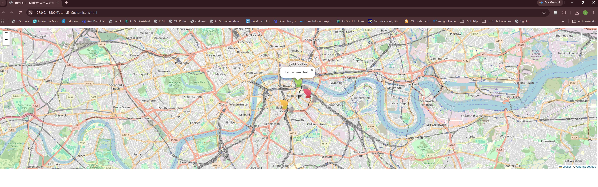
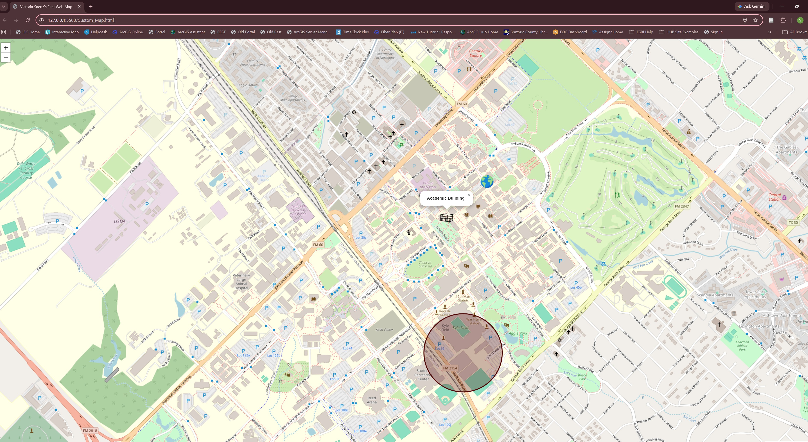
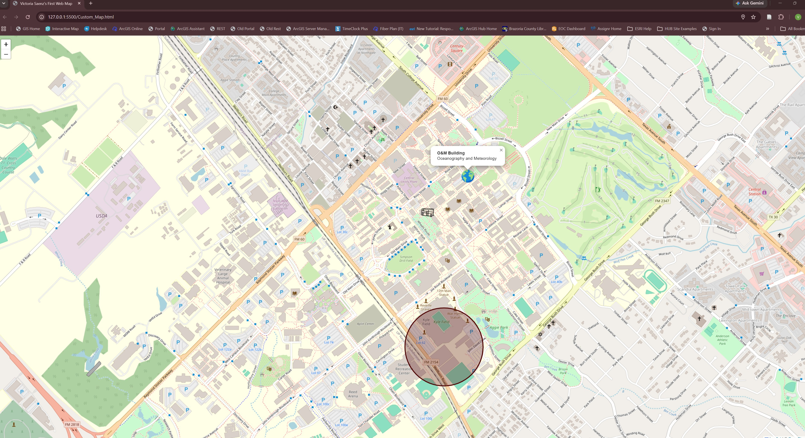
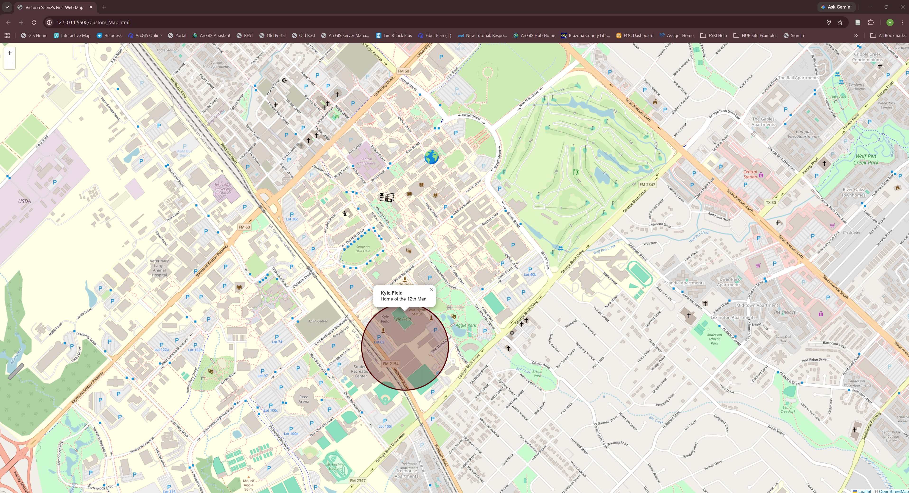
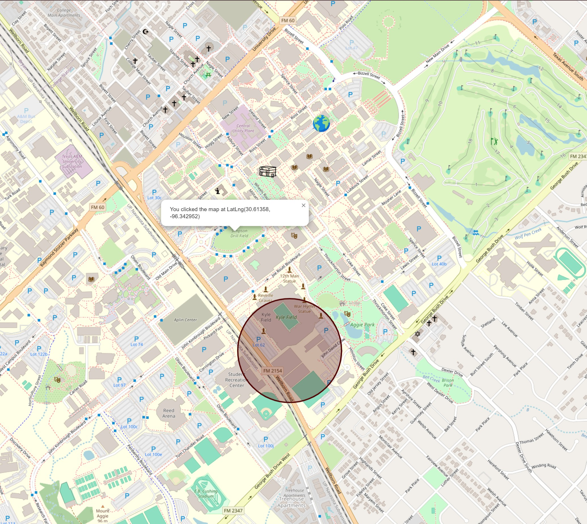

# Saenz-online-GEOG678-fall2026
# Lab 5

##Task 1

- Tutorial 1: Leaflet Quick Start Guide

    -  Note: When I tried to open the HTML in Chrome OpenStreetMap blocked the map tiles, so I had to use a local server to be able to open and view them.

- Tutorial 2: Leaflet on Mobile

- Tutorial 3: Markers with Custom Icons

##Task 2

- Screenshot of Academic Building Pop-up

- Screenshot of O&M Building Pop-up

- Screenshot of Kyle Field Pop-up

- Screenshot of Coordinates Pop-up
